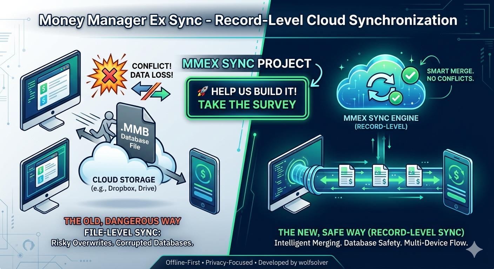

# MMEX Sync Engine (Sidecar Architecture in Rust)

> [!WARNING]
> This is a **Proof of Concept (POC)**, not production-ready software. It is still under active development and may not work perfectly in all edge cases.

[](https://github.com/moneymanagerex/mmex-sync/actions/workflows/pages/pages-build-deployment)
[](https://github.com/moneymanagerex/mmex-sync/actions/workflows/tests.yml)
[](https://github.com/moneymanagerex/mmex-sync/actions/workflows/release.yml)


[](https://github.com/moneymanagerex/mmex-sync/releases/latest)



## References
- [How to Contribute](CONTRIBUTING.md)
- [Setup PocketBase Server](README_POCKETBASE.md)
- [Disclaimer](DISCLAIMER.md)
- [First Run](docs/startup.md)

## 🎯 Overview

This project provides a high-performance, non-intrusive, **"Offline-First"** synchronization gateway for Money Manager Ex (MMEX), written entirely in **Rust**. It enables seamless multi-device record-level synchronization (Windows / Linux / macOS ↔ Cloud ↔ Android) without requiring any modifications to the core MMEX desktop C++ source code.

### The "Sidecar" Philosophy

The Sync Engine operates as a lightweight standalone native binary alongside MMEX. It tracks changes in your local SQLite database (`.mmb` or encrypted `.emb`) via SQL triggers and communicates with a **PocketBase** cloud backend. If the engine is off, MMEX remains a standard local app; if it's on, your data syncs across devices.

### Video
**Demo Video between Windows & Android**
[Demo Video between Windows & Android🤩](https://drive.google.com/file/d/1pKFcdcNuf47BQDFQAtPBOCC_B_BfgwxF/view)

**Demo Video between two Windows**
[Demo Video between two Windows🤩](https://1drv.ms/v/c/6958bccc4c47c1d3/IQAfDCUauF7dQo2GL1r47SziAfLlgfXdpo8-8-ustZM9CMA?e=5mPJBo)

### 📱 Android Sync App

For Android synchronization, you **must use** the specific sync-enabled version of the application:
* **File to use:** `ammx-X.Y.Z-sync-release.apk` (where `X.Y.Z` represents the version).
* **Download:** Available on the official GitHub repository releases: 👉 **[Latest Releases](https://github.com/moneymanagerex/android-money-manager-ex/releases/latest)**.

For detailed configuration instructions, refer to the [Sync Setup Guide (First Run)](docs/startup.md).

---

## ⚠️ IMPORTANT: DISCLAIMER & WARNING
**This is a Proof of Concept (POC).** This software is provided for **testing purposes only**. It is **NOT** intended for use with real, production, or important financial databases.

* **No Warranty:** This code is provided "as is" without any warranty of any kind.
* **Liability:** The author(s) decline any responsibility for data loss, database corruption, or financial discrepancies resulting from the use of this software.
* **Safety First:** Always use a **copy** of your database (e.g., `sample_db.mmb`) for testing.

> [!WARNING]
> Using this tool on your primary financial database is a great way to discover your inner "minimalist" by accidentally deleting your entire net worth. If your bank account suddenly looks as empty as a fridge on a Monday morning, don't say we didn't warn you! 💸🔥

---

## 🌐 Server Hosting Options

The Sync Engine requires a PocketBase backend to coordinate data across devices. You have two main options for setting up the server:

### 1. Community Shared Server (Easiest)
If you don't want to manage your own infrastructure, you can request access to the unofficial test shared instance hosted at:
👉 **[mmex-sync.prudenzano.org](https://mmex-sync.prudenzano.org)**

* **Self-Service Control Panel:** A portal is available at [mmex-sync.prudenzano.org/selfservice/](https://mmex-sync.prudenzano.org/selfservice/) where you can manage your sync data (export data, clear sync data, or completely delete your account).

> [!NOTE]
> Access to the shared server may require registration or approval. Please check the website for instructions on how to request your credentials.

### 2. Self-Hosted Server (Private & Control)
For maximum privacy and control over your financial data, you can easily deploy your own PocketBase instance on any cloud provider, VPS, or home server (e.g., Raspberry Pi, Docker, etc.).
* Download PocketBase from the official website.
* Deploy the required collections schema (see the `pb_schema_selfhost.json` file).
* Use your custom URL during setup (e.g., `http://your-vps-ip:8090`).

---

## 🕹️ How to Use

`mmex-sync` includes both a **Native Desktop GUI** (built with `eframe`/`egui`) and a **Headless CLI** mode.

### 0. Native Desktop GUI (Default Interactive Mode)

When you launch `mmex-sync` without CLI action arguments (by double-clicking the executable or running `mmex-sync` / `mmex-sync --gui`), the application opens the **Native Desktop GUI Dashboard**:

```bash
mmex-sync
# or explicitly:
mmex-sync --gui
```

From the Desktop GUI you can:
* **Manage Profiles** (`Profiles` menu): Create new profiles, switch between profiles, save changes, duplicate (`Save As...`), rename, set the default profile, or delete profiles.
* **Configure Local Database & Remote Server**: Select your `.mmb` or encrypted `.emb` file and MMEX executable using native OS file dialogs (**Browse**), configure PocketBase credentials, and test connectivity (**Test Connection**).
* **Run Sync Operations**: Trigger **Full Sync (Init + Push + Pull)**, **Push Only**, or **Pull Only** with real-time progress logs in the integrated console.
* **Switch Language** (`Preferences -> Language`): Supports **English** and **Italiano** with automatic OS locale detection on first launch.
* **Maintenance Tools** (`Tools` menu): Clean technical sync metadata/triggers from the local DB (`Clear Local DB`) or wipe remote server collections (`Clear Remote Server`).

---

#### 🔍 Profile Configuration Parameters in Detail

| Parameter | Field in Desktop GUI | Required | Description |
| :--- | :--- | :---: | :--- |
| **Profile Name** | `Active Profile` | Yes | Unique identifier for the profile (e.g., `default`, `personal`, `work`). |
| **Database Path** | `Database Path (.mmb / .emb)` | Yes | Absolute or relative path to your local Money Manager Ex database (`.mmb` standard SQLite file or `.emb` encrypted database). Supports `~` expansion and native OS file browsing. |
| **Database Password** | `Database Password (.emb)` | Conditional | Used when opening an encrypted `.emb` database to transparently decrypt/encrypt it during synchronization. |
| **Save DB Password** | `Save encrypted password in profile` | Optional | Securely stores the `.emb` password encrypted (AES-256-GCM) in the local profile file. |
| **Server Type** | `Server Type` | Yes | Remote backend provider (`pocketbase` by default). |
| **Server URL** | `Server URL` | Yes | HTTP/HTTPS endpoint of your PocketBase instance (e.g., `https://mmex-sync.prudenzano.org` or `http://127.0.0.1:8090`). |
| **Server User** | `User / Email` | Yes | Email address or username registered on your PocketBase instance. |
| **Server Password** | `Password` | Setup / Edit | Your PocketBase account password. Used to authenticate and obtain an encrypted JWT session token; plaintext passwords are never stored on disk. |
| **Auth Collection** | `Auth Collection` | Yes | PocketBase authentication collection name (defaults to `users`). |
| **MMEX Executable** | `MMEX Executable` | Required for `run`/`watch` | Path to your local Money Manager Ex executable (`mmex.exe` on Windows, or `mmex` on Linux/macOS). |
| **Default Mode** | `Default Mode` | Yes | Default execution mode for the profile: `run` (Sandwich Sync), `watch` (Real-time monitoring), or `sync` (Immediate headless sync). |

---

### 1. Daily CLI Workflow Modes

These CLI modes manage the lifecycle of the MMEX application directly from your terminal or desktop shortcut:

#### **`--run` (The "Sandwich" Sync):**
1. Performs an initial Sync (Init + Push + Pull).
2. Launches MMEX and waits for you to close it.
3. Performs a final Sync after MMEX closes to upload your latest changes to the cloud.

```bash
mmex-sync --run
```

#### **`--watch` (Real-Time Sync):**
1. Performs an initial Sync.
2. Launches MMEX.
3. Continuously monitors for local or remote changes while MMEX is running and syncs them automatically, performing a final sync when MMEX exits.

```bash
mmex-sync --watch
```

#### Set your default mode
You can change the saved default mode of the active profile via CLI:

```bash
mmex-sync --setDefaultMode=run
# or
mmex-sync --setDefaultMode=watch
```

### 2. Manual Headless Synchronization

Use these commands to synchronize data in headless mode without opening the GUI or launching MMEX:

* **Full Cycle:** `mmex-sync --sync` (Init + Push + Pull).
* **Pull Only:** `mmex-sync --sync=pull` (Download remote data only).
* **Push Only:** `mmex-sync --sync=push` (Upload local changes only).
* **Init Only:** `mmex-sync --sync=init` (Initialize sync schema and triggers without transmitting data).
* **Force Sync:** `mmex-sync --sync --force` (Processes all records regardless of timestamps or dirty flags).

### 3. Profile Management via CLI

You can manage multiple databases (e.g., `home` vs `work`) from the command line:

* **Select Profile:** `mmex-sync --profile=work --sync`
* **Set Default Profile:** `mmex-sync --setDefaultProfile=work`
* **Rename Profile:** `mmex-sync --profile=work --renameProfileTo=office`
* **List Profiles:** `mmex-sync --listProfile`
* **Show Profile Info:** `mmex-sync --showProfile` (or `mmex-sync --showProfile=work`)
* **Delete Profile:** `mmex-sync --deleteProfile=work`

---

### Command Line Reference

```text
Usage: mmex-sync [OPTIONS]

Options:
      --profile <PROFILE>                      Select configuration profile (e.g., 'home', 'work') [env: MMEX_PROFILE=]
      --ignoreProfile                          Ignore saved profile configuration and use defaults
      --listProfile                            List all available profiles in the configuration directory
      --showProfile [<SHOW_PROFILE>]           Show detailed profile configuration (default or specified)
      --deleteProfile [<DELETE_PROFILE>]       Delete the specified (or default) profile
      --setDefaultProfile < PROFILE>           Set default profile in mmex-sync.config.json
      --renameProfileTo <NEW_NAME>             Rename current profile to a new name
      --setDefaultMode <MODE>                  Set default operating mode for the profile (sync, run, watch)
      --db <DB>                                Path to Money Manager Ex database (.mmb or encrypted .emb) [env: MMEX_DB_PATH=]
      --filePassword <FILE_PASSWORD>           Password for encrypted .emb database [env: MMEX_FILE_PASSWORD=]
      --saveFilePassword <yes|no>              Save encrypted database password in profile (yes/no)
      --exe <EXE>                              Path to Money Manager Ex executable (mmex) [env: MMEX_EXE_PATH=]
      --create                                 Create and initialize a new empty local database from schema
      --serverType <SERVER_TYPE>               Remote backend provider (default: pocketbase) [env: MMEX_REMOTE_PROVIDER=]
      --url <URL>                              Remote server URL (e.g. http://127.0.0.1:8090) [env: MMEX_REMOTE_URL=]
      --user <USER>                            Remote authentication email/identity [env: MMEX_REMOTE_USER=]
      --pass <PASS>                            Remote authentication password [env: MMEX_REMOTE_PASS=]
      --sync [<OPS>]                           Run sync cycle (default: init,push,pull; or comma-separated init,push,pull)
      --force                                  Force processing of all records ignoring lastSync and dirty flags
      --run                                    Run Mode: Initial sync -> Launch MMEX -> Wait for exit -> Final sync
      --watch                                  Watch Mode: Initial sync -> Launch MMEX -> Real-time monitoring
      --clearDb                                Remove technical sync columns and triggers from local database
      --clearServer                            Delete all records from remote server collections (reverse dependency order)
      --verbose                                Enable detailed debug logging [env: MMEX_VERBOSE=]
      --nowait                                 Disable waiting for user input before closing
      --gui                                    Launch the Native Desktop GUI
      --nogui                                  Disable the Native Desktop GUI
      --checkForUpdate                         Check for updates
      --autoDownloadUpdate                     Automatically download and install update
  -h, --help                                   Print help
  -V, --version                                Print version
```

---

## 🛠️ Technical Concepts

* **100% Native Rust Architecture:** Compiles to a single standalone executable with bundled SQLite (`rusqlite`), pure-Rust TLS (`rustls`), pure-Rust cryptography (`aes-gcm`, `aes`, `cbc`, `pbkdf2`), and native GUI (`eframe`/`egui`).
* **Zero-Impact Integration:** Uses **SQLite Triggers** to track record-level modifications (`pb_is_dirty` flags) without touching MMEX's C++ code.
* **Loop Protection:** Implements a **3-State Protocol** (`0` = Synced, `1` = Local Change, `2` = Cloud Ingress) to prevent infinite sync loops.
* **Transparent `.emb` Encryption:** Supports Money Manager Ex encrypted `.emb` files out of the box using compatible AES-CBC key derivation and safe temporary workspace decryption.
* **Maintenance Commands:**
  * `--clearDb`: Removes all technical columns (`pb_id`, `pb_updated`, `pb_is_dirty`) and triggers from your local DB, restoring it to a standard Money Manager Ex database.
  * `--clearServer`: Wipes all data from the PocketBase collections in reverse foreign-key order without deleting your user account.

## Conclusion
This architecture proves that MMEX can be modernized with cloud capabilities while remaining a fast, stable, offline-first desktop application. It respects the existing codebase and provides a modular path forward for the community.
