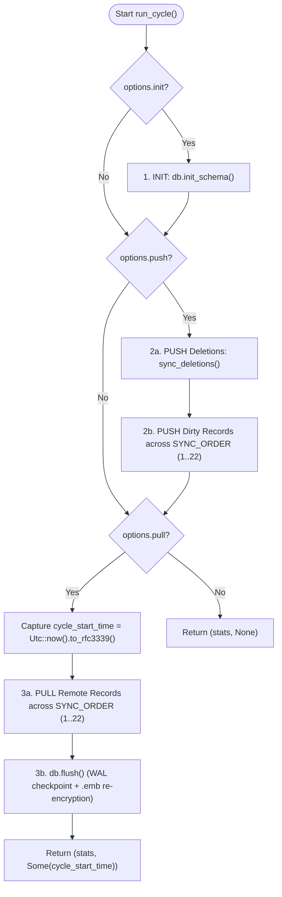

# AS-IS Technical Specification: 03 — Synchronization Engine and Execution Runner

> **Baseline Version:** `0.3.0` (Rust Edition 2021)  
> **Scope:** Step-by-step synchronization algorithm (`src/sync/engine.rs`), conflict resolution (`src/domain/conflict.rs`, `src/db/repository.rs`), timestamp management, error handling, and operating modes (`src/sync/runner.rs`).

---

## 1. Execution Runner Modes (`src/sync/runner.rs`)

`SyncRunner::run(requested_mode)` normalizes the mode string to lowercase (falling back to `config.default_mode`, which defaults to `"run"`) and dispatches to one of three workflows:

### 1.1 `sync` Mode (`execute_sync_mode`)
1. Instantiates `SyncEngine::new(self.db, self.remote, self.options.clone(), self.last_sync.clone())`.
2. Calls `engine.run_cycle().await?`, which returns `(SyncStats, Option<String>)`.
3. If `new_timestamp` is `Some(ts)` (which occurs whenever the `pull` phase runs):
   - Loads `<profile_name>.mmex-sync.json`, updates `profile.last_sync = Some(ts)`, and saves the profile back to disk.

### 1.2 `run` Mode — "Sandwich Sync" (`execute_run_mode`)
1. Checks if `self.mmex_exe` is configured and `exe.exists()` is true.
   - **Fallback:** If `mmex_exe` is `None` or the file does not exist on disk, logs a warning (`sync.mmex_not_configured_fallback`) and falls back to a single `execute_sync_mode().await`.
2. **Pre-Sync:** Executes `self.execute_sync_mode().await?`.
3. **MMEX Execution (Blocking):** Launches `Command::new(exe).arg(self.db_path).status()` and waits synchronously until the user closes Money Manager Ex.
4. **Post-Sync:** Executes `self.execute_sync_mode().await?` to push all changes made during the MMEX session.
   - *(Note: in AS-IS `execute_run_mode`, `self.last_sync` on `SyncRunner` is not updated in-memory between the pre-sync and post-sync calls, though the profile file on disk is updated after each `execute_sync_mode`.)*

### 1.3 `watch` Mode — Real-Time Polling (`execute_watch_mode`)
1. **Initial Pre-Sync:** Executes `self.execute_sync_mode().await?`.
2. **Detached MMEX Launch:** If `self.mmex_exe` is configured and exists, spawns MMEX in the background via `Command::new(exe).arg(self.db_path).spawn()`.
3. **File Modification Polling Loop:**
   - Records initial `last_modified = std::fs::metadata(self.db_path).and_then(|m| m.modified()).ok()`.
   - Loops indefinitely (`loop { sleep(Duration::from_secs(3)).await; ... }`):
     - Reads current `modified()` timestamp of `self.db_path`.
     - If `current_mod != last_modified && current_mod.is_some()`, updates `last_modified = current_mod` and runs `SyncEngine::run_cycle().await`.
     - On `Ok((_stats, Some(ts)))`, updates both `self.last_sync` in memory and `profile.last_sync` on disk.

### 1.4 GUI Execution of `sync`, `run`, and `watch` Modes (`MmexSyncGuiApp::trigger_default_mode_async`)
When triggered via the 3-second auto-start countdown or the `▶️ Run (<MODE>)` button in the desktop GUI (`src/gui/app.rs`):
- **`sync`**: Delegates to `trigger_sync_async(true, true)`.
- **`run`**: Spawns a background worker thread that executes Pre-Sync (`execute_single_sync_step`), launches `mmex_exe` blocking on the worker thread (`Command::new(exe).arg(&ctx.db_path).status()`), and upon MMEX exit runs Post-Sync (`execute_single_sync_step`) and persists the updated `lastSync` timestamp. If `mmex_exe` is missing or not configured, logs `sync.mmex_not_configured_fallback` and finishes after Pre-Sync.
- **`watch`**: Spawns a background worker thread that executes Pre-Sync, spawns `mmex_exe` in the background if configured, and polls `std::fs::metadata(&ctx.db_path).modified()` every 3 seconds (in 200ms slices checking `watch_stop_flag: Arc<AtomicBool>` so the user can stop monitoring at any time via the `⏹️ Stop Watch` button or `Esc`), running `execute_single_sync_step` whenever the database file changes.

---

## 2. `SyncOptions` Parsing (`src/sync/engine.rs`)

- When invoked via CLI (`SyncOptions::from_cli_sync`):
  - `--sync` not passed (`None`), unless `--run` or `--watch` is active (in `main.rs`, `args.sync.as_ref().or(Some(&None))` forces `Some(None)`):
    - `Some(None)` (i.e. `--sync` with no value, or `--run` / `--watch` / default mode): `init = true`, `push = true`, `pull = true`.
    - `Some(Some(s))` (e.g. `--sync=init,pull`): splits `s` by `','`, trims and lowercases each token, setting `init`, `push`, and `pull` booleans based on token presence.
- When invoked via GUI (`trigger_sync_async(push, pull)`):
  - Always sets `init = true`, with `push` and `pull` determined by the clicked button (`Full Sync`: `true, true`; `Push Only`: `true, false`; `Pull Only`: `false, true`).

---

## 3. Step-by-Step Synchronization Cycle (`SyncEngine::run_cycle`)

A synchronization cycle consists of three sequential phases executed in strict order: **INIT -> PUSH -> PULL**.



### Phase 1: INIT (`self.options.init == true`)
Calls `self.db.init_schema()`:
- Creates `pb_sync_info` (`VERSION = 3`) and `pb_DELETED_RECORDS_LOG` if missing.
- Ensures `pb_id`, `pb_is_dirty`, and `pb_updated_at` columns exist on all 22 tables in `SYNC_ORDER`.
- Ensures `TRG_<table>_INSERT`, `TRG_<table>_UPDATE`, and `TRG_<table>_DELETE` triggers exist on all 22 tables.
- Refreshes the in-memory table schema cache (`self.schemas`).

---

### Phase 2: PUSH (`self.options.push == true`)

#### Step 2a: Soft-Delete Propagation (`sync_deletions`)
1. Reads all rows `(table_name, pb_id, deleted_at)` from `pb_DELETED_RECORDS_LOG`.
2. For each entry, builds a JSON payload:
   ```json
   {
     "_is_deleted": true,
     "_updated_at": "<entry.deleted_at or Utc::now().to_rfc3339()>"
   }
   ```
3. Calls `self.remote.update(&entry.table_name, &entry.pb_id, &payload).await`:
   - **`Ok(_)` or `Err(SyncError::NotFound(_))`**: Removes the entry from `pb_DELETED_RECORDS_LOG` (`remove_deleted_record_log`) and increments `stats.deleted_records`.
   - **Any other `Err(err)`**: Logs a warning (`sync.soft_delete_failed`) and keeps the entry in `pb_DELETED_RECORDS_LOG` for retry on the next sync cycle.

#### Step 2b: Table-by-Table Record Push (`push_table`)
Iterates through all 22 tables in topological `SYNC_ORDER`:
1. Queries local records via `self.db.get_dirty_records(table, self.options.force)`:
   - Normal mode (`force == false`): `SELECT *, ROWID as rowid FROM <table> WHERE pb_is_dirty = 1 OR pb_id = '' OR pb_id IS NULL`
   - Force mode (`force == true`): `SELECT *, ROWID as rowid FROM <table>`
2. For each `LocalRecord`:
   - Converts all domain fields (plus the table's Primary Key column, since `fields` in `LocalRecord` contains every column except `rowid`, `pb_id`, `pb_is_dirty`, `pb_updated_at`) into a JSON map via `local_record_to_json(&record)`.
   - Inserts `"_updated_at": record.pb_updated_at.unwrap_or_else(|| Utc::now().to_rfc3339())`.
   - **Case A — Record already has `pb_id` (`Some(pb_id)`):**
     - Calls `self.remote.update(table, pb_id, &payload).await`:
       - **`Ok(resp)`**: Calls `self.db.set_synced_status(table, record.rowid, &resp.id)` (`pb_is_dirty = 0, pb_id = resp.id`) and increments `stats.pushed_records`.
       - **`Err(SyncError::NotFound(_))` (HTTP 404):** Record was deleted on the server; falls back to `self.remote.create(table, &payload).await`. On success, updates local `pb_id` and sets `pb_is_dirty = 0`; on error, delegates to `handle_push_error`.
       - **`Err(SyncError::Conflict(_))` (HTTP 409):** Increments `stats.conflicts_resolved`, fetches the authoritative remote record via `self.remote.get_by_id(table, pb_id).await`, and applies it locally via `self.db.apply_remote_changes(table, &remote_rec)`.
       - **`Err(err)`**: Delegates to `handle_push_error`.
   - **Case B — Record has no `pb_id` (`None`):**
     - Calls `self.remote.create(table, &payload).await`:
       - **`Ok(resp)`**: Calls `self.db.set_synced_status(table, record.rowid, &resp.id)` and increments `stats.pushed_records`.
       - **`Err(err)`**: Delegates to `handle_push_error`.

#### Step 2c: Push Error & Remote Uniqueness Conflict Resolution (`handle_push_error`)
When `create` or `update` fails during PUSH:
1. **If `error` is `SyncError::UniqueConstraintViolation`:**
   - Attempts to locate the conflicting record on the remote server:
     1. First tries `self.remote.get_by_row_id(table, record.rowid).await` (searches by the table's Primary Key column matching `record.rowid`).
     2. If not found, iterates over `get_table_config(table).unique` constraints (`Single` or `Composite` text columns) and queries `self.remote.get_by_unique_keys(table, &keys).await` (which filters by `_is_deleted = 0`).
   - If a matching `remote_rec` is found:
     - Determines `old_pk` from `record.fields.get(schema_pk)` (or `record.rowid`).
     - Calls `self.db.replace_record_and_references(table, record.rowid, old_pk, &remote_rec)` to overwrite the local record with the remote record, realign its Primary Key to the remote Primary Key, and cascade the PK change across all referencing Foreign Key columns in `SYNC_ORDER`.
     - Increments `stats.conflicts_resolved` and returns `Ok(())`.
2. **For any other error (or if uniqueness lookup finds no record):**
   - Logs a warning (`sync.push_record_error`) with `table`, `rowid`, and `error`, and continues processing the remaining records without aborting the table loop.

---

### Phase 3: PULL (`self.options.pull == true`)

1. **Timestamp Capture:** Captures `cycle_start_time = Utc::now().to_rfc3339()` **before** downloading from the first table.
2. **Table-by-Table Pull (`pull_table`):** Iterates through all 22 tables in `SYNC_ORDER`:
   - **Delta Filter Construction:**
     - If `self.options.force == true` or `self.last_sync.is_none()`: `filter = None` (downloads all records in the collection).
     - If `self.last_sync` is `Some(ts)`:
       - Parses `ts` as RFC-3339 (`DateTime::parse_from_rfc3339(ts)`).
       - Subtracts a **5-second safety buffer** (`parsed - ChronoDuration::seconds(5)`) to guard against clock skew between devices/server.
       - Formats filter: `_updated_at > "<buffered_rfc3339>"` (if RFC-3339 parsing fails, uses raw `ts`).
   - Calls `self.remote.get_full_list(table, filter_str.as_deref()).await?`.
   - For each `RemoteRecord` returned:
     - Calls `self.db.apply_remote_changes(table, remote)?`.
     - Increments `stats.pulled_records`.
   - Calls `self.db.reset_unfinished_ops(table)?` (`UPDATE <table> SET pb_is_dirty = 1 WHERE pb_is_dirty = 2`).
3. **Database Flush:** Calls `self.db.flush()?` (note: in AS-IS `run_cycle`, `self.db.flush()` is called inside the `if self.options.pull` block).
4. **Return Value:** Returns `Ok((stats, Some(cycle_start_time)))`.

---

## 4. Transactional Pull Application & Local Conflict Resolution (`DatabaseService::apply_remote_changes`)

For each incoming `RemoteRecord` on `table`:
1. Looks up `existing_rowid = self.find_rowid_by_pb_id(table, &remote.id)?` (`SELECT ROWID FROM <table> WHERE pb_id = ?`).
2. Starts a SQLite transaction (`let tx = self.conn.transaction()?`).
3. **Branch 1: Record with matching `pb_id` already exists locally (`Some(rowid)`):**
   - **If `remote.is_deleted == true`**:
     - Executes `DELETE FROM <table> WHERE ROWID = ?`.
     - *(Note: `TRG_<table>_DELETE` fires on this delete and inserts `(table, pb_id)` into `pb_DELETED_RECORDS_LOG` because `OLD.pb_id IS NOT NULL`.)*
   - **If `remote.is_deleted == false`**:
     - Builds `UPDATE <table> SET <field1> = ?, ..., pb_is_dirty = 2, pb_updated_at = ? WHERE ROWID = ?`.
     - Immediately executes `UPDATE <table> SET pb_is_dirty = 0 WHERE ROWID = ?` within the same transaction.
4. **Branch 2: No local record has `pb_id` (`None`) and `remote.is_deleted == false`:**
   - Builds `INSERT INTO <table> (<pk>, <fields...>, pb_id, pb_is_dirty, pb_updated_at) VALUES (?, ..., ?, 2, ?)`.
   - Note that the remote record's Primary Key value (`remote.fields.get(&schema.pk)`) is explicitly included in the `INSERT` statement.
   - **If `INSERT` succeeds:**
     - Fetches `last_id = tx.last_insert_rowid()` and executes `UPDATE <table> SET pb_is_dirty = 0 WHERE ROWID = ?`.
   - **If `INSERT` fails with `rusqlite::ErrorCode::ConstraintViolation`:**
     - Drops the failed transaction (`drop(tx)`).
     - Searches for a pre-existing local record matching any configured unique constraint (`self.find_rowid_by_unique_keys(table, remote)?`).
     - If found (`Some((conflict_rowid, conflict_pk))`), calls `self.replace_record_and_references(table, conflict_rowid, conflict_pk, remote)?`, which overwrites the local record (including setting its PK to the remote PK) and cascades any PK change across all referencing FK columns in `SYNC_ORDER`.
     - If no unique-key match is found (e.g., the constraint violation was on the Primary Key itself rather than a secondary `UniqueConstraint` in `get_table_config`), returns `Err(SyncError::UniqueConstraintViolation)`.
5. **Branch 3: No local record has `pb_id` (`None`) and `remote.is_deleted == true`:**
   - No-op (commits empty transaction).

---

## 5. Unused / Helper Domain Functions (`src/domain/conflict.rs`)

The file `src/domain/conflict.rs` defines two pure domain helper functions that are exported by `crate::domain` (available for unit tests or future evolution, though not directly called by `SyncEngine` in AS-IS):
- `resolve_lww_conflict(local_updated_at, remote_updated_at) -> ConflictResolutionAction`: Compares ISO-8601 timestamp strings lexicographically (`rem >= loc` -> `ApplyRemote`, else `KeepLocal`).
- `check_pk_cascade_needed(pk_name, local, remote) -> Option<(i64, i64)>`: Returns `Some((local_pk, remote_pk))` if both records contain an integer PK and `local_pk != remote_pk`.

---

## Invarianti di Sistema

1. **Topological Execution Order (`SYNC_ORDER`):** Both `PUSH` and `PULL` phases MUST iterate over the 22 MMEX tables strictly in `SYNC_ORDER` (Level 1 independent tables -> Level 2 master tables -> Level 3 core entities/transactions -> Level 4 child/split/link tables) so parent records and their Primary Keys exist before dependent records are processed.
2. **Pre-Pull Timestamp Capture & 5-Second Clock-Skew Buffer:**
   - The new `lastSync` timestamp (`cycle_start_time`) MUST be captured **before** starting the `PULL` loop so any remote changes occurring while `PULL` is in progress are still picked up on the next cycle.
   - Incremental `PULL` queries MUST subtract 5 seconds from `lastSync` (`_updated_at > "<lastSync - 5s>"`) to prevent missing records due to minor clock drift.
3. **Soft-Deletes Before Upserts in PUSH:** `sync_deletions()` MUST execute before `push_table()` so that if a user deletes a record with a unique name (e.g., an account or category) and recreates a new one with the same name in the same session, the remote soft-delete is processed first.
4. **Non-Fatal Record Push Errors:** A failure to push an individual record in `push_table` (other than an unhandled DB error) MUST be logged via `warn!` in `handle_push_error` without aborting the synchronization of remaining records and tables.
5. **Bidirectional Uniqueness Resolution with FK Cascade:** Both `PUSH` (on remote HTTP 400 `validation_not_unique`) and `PULL` (on local SQLite `ConstraintViolation`) MUST resolve natural-key collisions by adopting the remote record's `pb_id` and Primary Key and cascading `old_pk -> new_pk` across all referencing Foreign Key columns defined in `get_referencing_fk_columns`.

